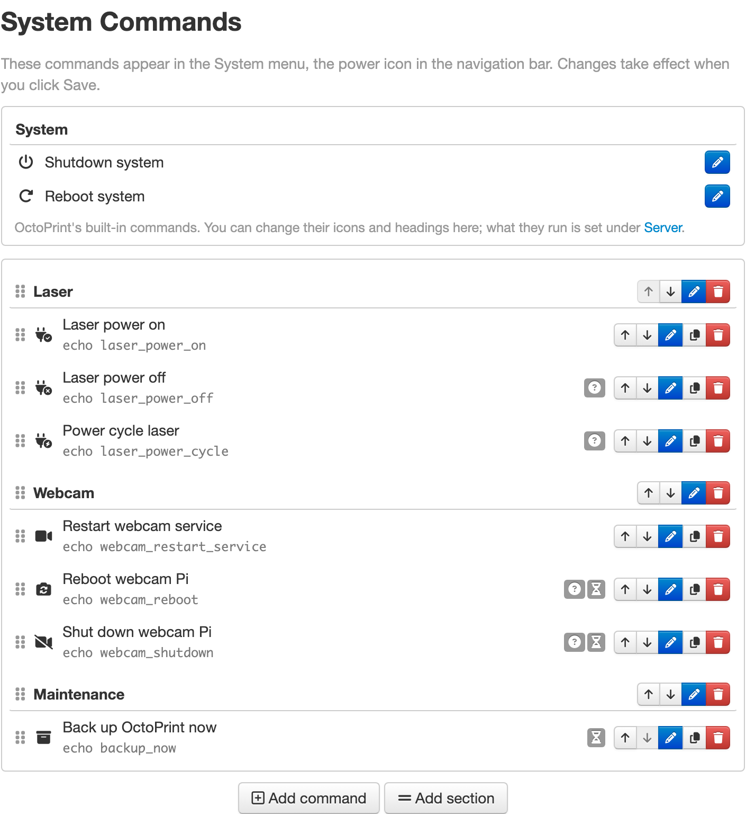
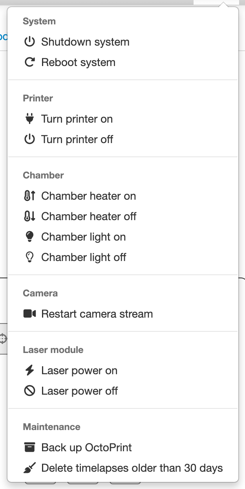
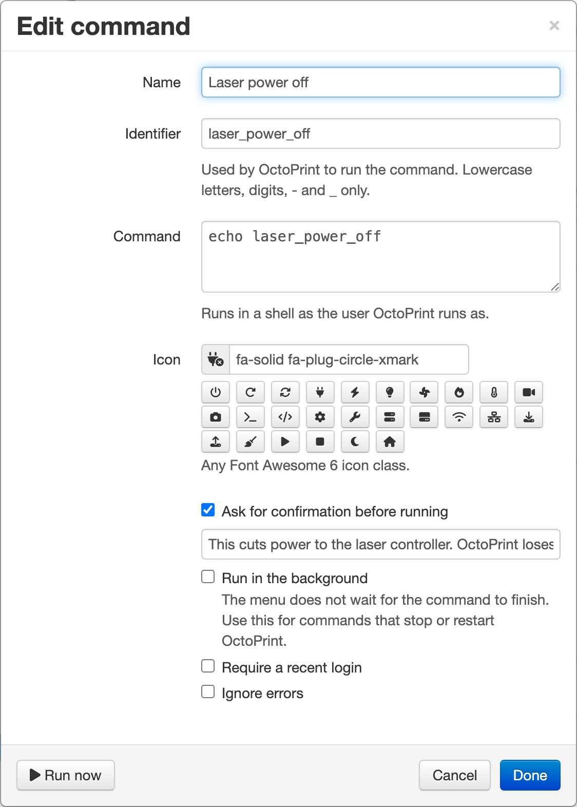

[](https://synman.github.io/OctoPluginStats/#systemcommandeditorContainer)
# System Command Editor Plugin for Octoprint

Add, edit, reorder and group the commands in OctoPrint's System menu, the power icon in the navigation bar,
from **Settings → Plugins → System Command Editor**.







## What it does

- Lists your commands the way the System menu shows them, with buttons on each row to move, edit, duplicate
  and delete it. Drag a row by its handle to move it.
- **Add command** opens an editor for the name, the shell command, an icon and these options:
  - ask for confirmation, with your own message
  - run in the background, for commands that stop or restart OctoPrint
  - require a recent login
  - ignore errors
- **Add section** adds a divider line, with an optional heading that the System menu shows above the
  commands that follow it.
- **Add control** adds a control: one row in the System menu that gathers commands. See Controls below.
- **Add from presets** offers ready-made switches, readouts, maintenance commands and plugin controls. See
  Add from presets below.
- **Run now** in the editor runs a saved command so you can try it.
- OctoPrint's built-in entries (Shutdown, Reboot, Restart, Restart in safe mode) get icons. Shutdown's heading is
  "System" out of the box. Their rows at the top of the editor let you change those icons and headings. What they
  run stays under **Settings → Server**, and they appear only once a command is set there.
- The System menu shows each command's icon and each section's heading. Only the plugin's own CSS and
  JavaScript are used; OctoPrint itself is not modified. Icons come from the settings, so users who may run
  system commands but not change settings see headings without icons.

Changes take effect when you click **Save** in the settings dialog. On OctoPrint 2.0 you are asked for your
password, because OctoPrint requires a recent login to change system commands.

## Controls

A control is one row in the System menu. It gathers commands, or shows a status. The editor has four types:

- **Switch**: a power button for something that is on or off, like a smart plug. It has an On command and an
  Off command. It can also have Restart and Restart in safe mode commands. With a status, the menu shows
  one power button: Off while the switch is on, On while it is off. While its state is unknown, the button is
  shown disabled. A switch with no status shows separate On and Off buttons.
- **Selector**: a drop-down in the menu with one command for each choice. The menu shows the name of the choice
  that matches the status. When the status matches no choice, it shows Unknown.
- **Action**: a row with one button for each Run command. The row itself runs nothing. A status, if the action has
  one, shows under its name.
- **Readout**: shows only a status text, with no buttons. A readout is drawn in the menu only where it is placed
  in the custom list.

## Command kinds

The editor's **Kind** choice has two values: a shell command, or a link. A link opens a page in a new tab.

Commands made by presets can run more kinds, which the editor keeps as they were saved:

- a plugin's helper, API call or method
- G-code lines (these can be edited in the editor)
- an OctoPrint built-in: a printer call (connect, pause, cool down, emergency stop and similar), G-code, or a
  custom event
- an MQTT publish (its topic and payload can be edited in the editor)

## Status

A control's state comes from one of two places:

- a **status command**, a shell command that the server runs
- a **read**, which asks a plugin, an MQTT topic or the printer

For a switch, the output is checked against an **On pattern** and an **Off pattern**, both regular expressions.
The first pattern that matches decides the state. If neither pattern matches, the state is unknown. With no
patterns, exit code 0 means on and any other exit code means off.

A readout or an action shows the first line of its output, and either can have a **Format**, which uses Python's
format syntax with `{value}`, for example `{value:.1f}%`. The Format field links to the Python reference for the
syntax. If the pattern cannot be used, the first line is shown as it is. A selector matches the whole output
against its choices.

The printer's own reads answer bare numbers, so the Format decides how they look:

- **Job progress** (`printer: progress`) is the percent done, such as `41.2`. The preset's Format is
  `{value:.0f}%`. With no job it is blank.
- **A temperature** (`printer: temperature` with an `item`) is one item of OctoPrint's temperatures, by its name:
  `tool0`, `bed`, `chamber`, or any item a plugin adds. Its Format can name `{actual}` and `{target}`, for
  example `{actual:.0f}/{target:.0f} °C`; `{value}` is the actual. An item with no target leaves a Format that
  names `{target}` unapplied and shows the actual. With `field: actual` or `field: target` in `config.yaml` the
  read is that one number, for `{value}`. An item the printer does not report is blank.

The presets offer one temperature readout per item: the tools, bed and chamber the printer profile has, then
every other item the printer reports at that moment.

A status command that runs longer than 10 seconds is stopped, and its control shows Unknown.

**Live updates** is off by default. When it is on, and the System menu is open, the menu checks the status of
every control again on a timer. The interval is in seconds, at least 1, and 5 by default. A read saved with
`live: false` is skipped during live updates. Each update runs every status command on the OctoPrint server.

## Add from presets

**Add from presets** lists what this system and its plugins offer. Tick a row to add it.

The popup groups presets by the kind of control they make: Switches, Actions, Readouts, and Commands for a preset
that adds a command with no control. A kind with nothing to show has no heading. Each row says where it comes from: OctoPrint, this system, or
the plugin's name.

**Only show what this system has** is on when the popup opens. It leaves out a preset this system cannot use,
such as a webcam service that is not installed, and says how many it left out. Turn it off to see every preset;
one that is not available says why at the end of its row. A preset that is already added always stays listed, so
it can be removed.

The presets come from these sources. These are sources, not the popup's headings:

- **OctoPrint's own commands**: a Host switch, named after this machine, with reboot and shutdown; and an
  OctoPrint switch, with restart and restart in safe mode. These join OctoPrint's own commands.
- **System readouts**: free disk, free memory, load, uptime, CPU temperature, power and throttling,
  IP address and Wi-Fi signal.
- **Maintenance**: back up OctoPrint, delete timelapses older than 30 days, delete logs older than 7 days, sync
  the clock, turn Wi-Fi power saving off, and update the system's packages. A row that the system does not
  support says so in the picker.
- **Webcam services**: one switch for each known webcam or stream service. A service that is not on this system
  is marked as not detected. A service that needs passwordless sudo says so in its note.
- **OctoPrint**: a Connection switch, current job commands (pause, resume, cancel), printer commands (home, cool
  down, emergency stop), a G-code macro, a custom event, and a webcam snapshot link when a snapshot URL is set.
- **Plugins**: presets from each of these plugins that is installed and enabled: PSU Control, TP-Link Smartplug,
  Tasmota, OctoRelay, GPIO Control, USB Relay Control, Better Grbl Support, and MQTT.

When there are no controls yet, the plugin adds the OctoPrint Connection switch on first start. It also adds each
switch from the other groups that is not marked as unavailable.

An MQTT command never sets the retain flag. The MQTT plugin retains a publish when the flag is left out, and its
broker setting defaults to retained. A switch's command would then run again each time the connection came back.

## Conditions and confirmation

A command can be limited in two ways. Each limit either hides the command or grays it out in the menu. A grayed-out
command says why in a tooltip.

- **Printer states**: a command can be available only while the printer is in some states, or not while it is in
  some states. The states are printing, paused, ready, offline and error.
- **Control states**: a command in a control can be available only while the control is in some of its states.
  The editor reads the control's list of states ("Available when ... is:"). When the list is known, the states
  are checkboxes. Otherwise you type them in. A control that reads a number, such as the current job's percent
  or the temperatures, has no states and offers no limit. An unknown state never blocks a command. A built-in OctoPrint
  command is never judged by its control's state.

If a limited command is run anyway, the server refuses it and gives the same reason.

Presets add a limit only where the command cannot work in that state. For example, Better Grbl Support's Home
runs only when the control is Idle or Alarm, and its Sleep does not run while it is in Sleep. The Pause command
runs only while printing, and Resume only while paused. Printer Home does not run while printing.

A command with a confirmation shows its message, then the command as it will run: a shell command as typed, a
link as `Link: <url>`, G-code lines after `G-code:`, or a plugin call with its arguments.

## For plugin authors: the `state_values` helper

A plugin can tell the editor which state words its status read can report. It does this by exporting a helper
named `state_values`. The helper is a function with no arguments that returns a list of strings. The editor calls
it on the OctoPrint server, and offers those words in the "Available when" picker.

```python
# in your plugin's __init__.py

def state_values():
    # the words this plugin's status read can report
    return ["On", "Off", "Fault"]

__plugin_helpers__ = {
    "state_values": state_values,
}
```

Better Grbl Support adds this helper in a version that is not released yet. Until a plugin exports it, the editor
uses a built-in list for Better Grbl Support. That list
holds its Grbl states: Idle, Run, Hold, Jog, Alarm, Door, Check, Home, Sleep, Reset and N/A. For any other plugin,
the picker is a text box.

## Examples

Any shell command the OctoPrint user can run works. Some common ones for a printer setup:

| Section | Command | What it runs |
|---|---|---|
| Printer | Turn printer on / off | `curl -s "http://printer-plug.local/cm?cmnd=Power%20On"` on a Tasmota smart plug (`Power%20Off` to turn it off) |
| Chamber | Chamber heater on / off | the same `curl` against the heater's smart plug |
| Chamber | Chamber light on / off | `pinctrl set 17 op dh` / `pinctrl set 17 op dl` for a relay on a Raspberry Pi GPIO pin |
| Camera | Restart camera stream | `sudo systemctl restart camera-streamer` |
| Laser module | Laser power on / off | the same `curl` against the laser's smart plug |
| Maintenance | Back up OctoPrint | `~/oprint/bin/octoprint plugins backup:backup`, run in the background |
| Maintenance | Delete old timelapses | `find ~/.octoprint/timelapse -name '*.mp4' -mtime +30 -delete` |

Turn on **Ask for confirmation** for anything you would not want to click by mistake, like turning the printer off
while the hotend is still hot. A command that uses `sudo` needs a sudoers rule that lets the OctoPrint user run it
without a password. Host names, GPIO pins and paths depend on your setup.

## Where your commands are kept

Commands are stored where OctoPrint keeps them, under `system.actions` in `config.yaml`. The plugin keeps no
copy of its own. If you uninstall it, your commands stay in the System menu. Icons and section headings are
saved with the commands as two extra keys, `icon` and a divider's `name`, which OctoPrint ignores. The icons
and headings of OctoPrint's built-in entries have nowhere to go in OctoPrint's own settings, so they are kept in
the plugin's settings under `plugins.systemcommandeditor.core`.

## Upgrading from 1.x

Versions before 2.0 kept a second copy of the commands in the plugin's own settings and copied it back over
`system.actions` on every start. That could wipe commands on a fresh install, and its editor could save
several copies of a new command.

On the first start after upgrading, 2.0 converts your commands in place, once:

1. Both lists are saved to `data/systemcommandeditor/pre-2.0-backup-<date>.yaml` in OctoPrint's base folder.
2. Commands from the plugin's copy that are missing from `system.actions` are added back at the end.
3. Duplicate commands, which share an identifier, are reduced to the first one.
4. Repeated dividers, a plain divider at the start, and any divider at the end are removed.
5. The plugin's copy is deleted.

The result is written to `octoprint.log`, for example:

```
Converted system commands: 4 commands, 2 duplicates removed ['restart'], 1 restored from the plugin's old copy ['wifi'], 0 invalid entries skipped
```

## Upgrading to 2.1

The plugin's settings have a version number, now 10. On the first start after upgrading, OctoPrint runs one step
for each version the saved settings are behind. Each step changes only what its name says, and each one writes a
line to `octoprint.log` when it changes something:

- **Readouts** get a place in the custom commands list, after the last entry of their section, or at the end.
- **Presets** that are already in use are marked, so the picker can track them by id.
- **Link controls** become standalone link commands at the end of the list.
- **TP-Link and Tasmota plug reads** that were saved with live updates off get live updates again.
- **On and Off switch commands** that had the old default icons get the toggle icons, and then the power icon:
  green for On, red for Off.
- **MQTT publish commands** are saved as non-retained.
- **Job progress controls** with no Format get `{value:.0f}%`, which used to be built in.

The Printer preset no longer shows a line of temperatures. A Printer control saved with that line keeps it. For
new ones, add the temperature readouts from the presets.

## Requirements

OctoPrint 1.9 or newer, including 2.0, on Python 3.7 or newer. 2.0 was tested on 1.9.3, 1.10.3, 1.11.8 and
2.0.0rc5. 2.1 was tested on 1.11.8 and 2.0.0rc5.

## Setup

Install it through the Plugin Manager, or with the Python that runs OctoPrint:

    pip install https://github.com/synman/OctoPrint-SystemCommandEditor/archive/master.zip

## Development

Python unit tests cover the conversion, the upgrade steps, the status checks, the presets and the API. They import
OctoPrint's own modules, so run them with a Python that has OctoPrint installed:

    pip install pytest
    python -m pytest tests

Node tests cover the pure model behind the System menu and the editor. They need only Node.js:

    node --test tests/
    node tests/menu_model.test.js

Browser probes and live proofs are scripts under `tests/`. Each one needs:

- `tests/sce-editor-probe.py`: Playwright for Python, and an OctoPrint with this plugin at `SCE_BASE` (default
  `http://127.0.0.1:5097`). The settings are answered from a fixture, so no server setting changes.
- `tests/sce-menu-probe.py`: Playwright for Python, and an OctoPrint with this plugin at `SCE_BASE` (default
  `http://127.0.0.1:5097`). Every API the menu uses is answered from a fixture, so no server setting changes.
- `tests/sce-rig-proof.py`: Playwright for Python, a base URL, and a rig folder that holds an `apikey` file. It
  seeds test commands through the settings API, drives the System menu, and restores the rig's settings afterwards.
- `tests/sce-plugin-proof.py`: a live OctoPrint with PSU Control, Better Grbl Support and MQTT enabled, the test
  records named in its docstring, the arguments for the base URL, the base folder and the Grbl port, and the
  `requests` and `PyYAML` packages.
- `tests/sce-mqtt-proof.py`: a live OctoPrint with the MQTT plugin on an unauthenticated broker, the
  `mosquitto_pub` and `mosquitto_sub` commands, and the `requests` and `PyYAML` packages. It refuses to run when
  the broker has a username.

Files:

| Path | What it holds |
|---|---|
| `octoprint_systemcommandeditor/__init__.py` | the plugin, its API, its settings steps and the upgrade from 1.x |
| `octoprint_systemcommandeditor/convert.py` | the conversion of 1.x commands and the 2.1 settings steps, no OctoPrint imports |
| `octoprint_systemcommandeditor/adapters.py` | calls to other plugins, MQTT reads, printer calls, and the command and control checks |
| `octoprint_systemcommandeditor/status.py` | the status checks, the On and Off patterns and the readout Format |
| `octoprint_systemcommandeditor/presets.py` | the ready-made presets and the state word lists |
| `octoprint_systemcommandeditor/templates/systemcommandeditor_settings.jinja2` | the settings pane and editor |
| `octoprint_systemcommandeditor/static/js/systemcommandeditor.js` | the settings pane and editor logic |
| `octoprint_systemcommandeditor/static/js/systemcommandeditor_menu.js` | icons, headings and controls in the System menu |
| `octoprint_systemcommandeditor/static/css/systemcommandeditor.css` | styles for both |
| `tests/` | pytest suites, Node tests, and the browser probes and live proofs |
